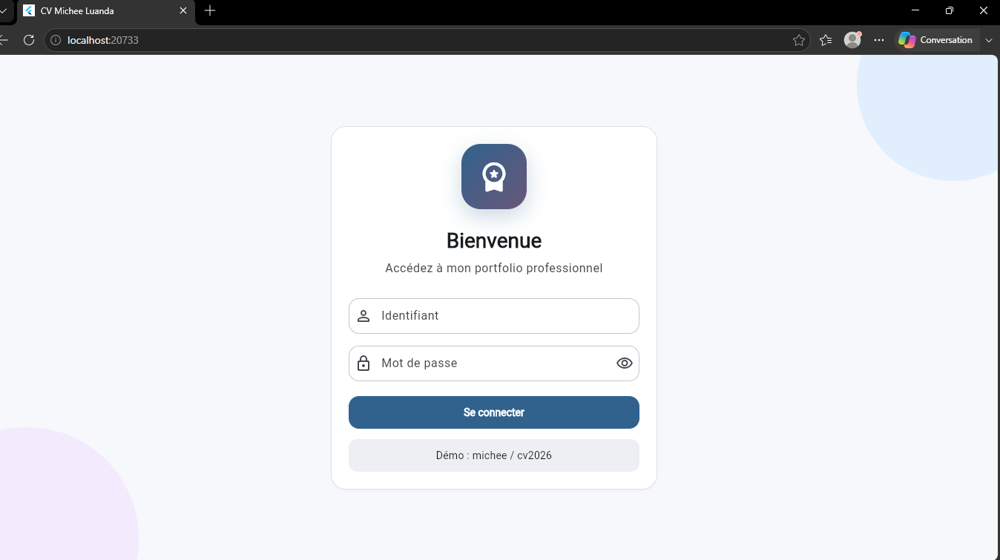
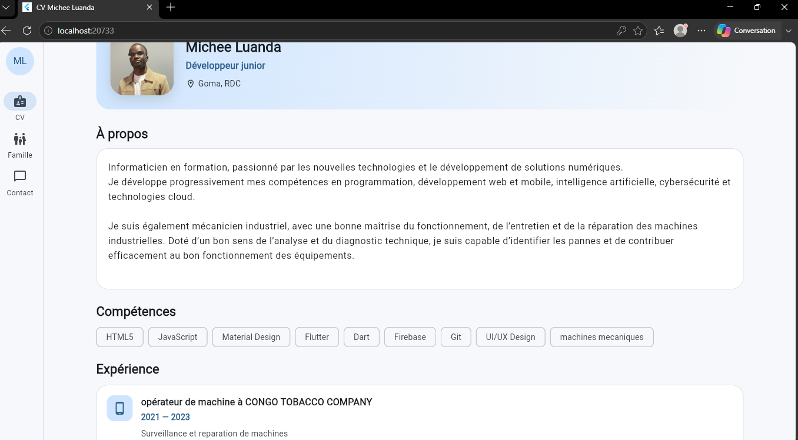
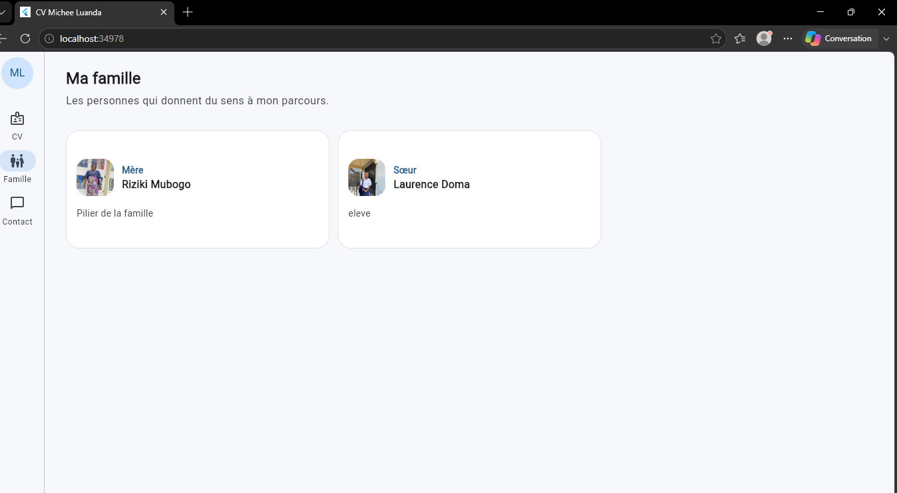

# cv_flutter_michee

Application Flutter de présentation professionnelle de Michee Luanda : CV, famille, compétences, expérience et informations de contact.

## Aperçu de l'application

### Page de connexion

La page d'authentification permet d'accéder à l'application et présente une interface simple, moderne et adaptée aux écrans mobiles.

### Page d'accueil

La page d'accueil présente le profil professionnel, les informations principales et les contenus essentiels du CV.

### Page Famille

La page Famille met en valeur les proches de Michee avec leur lien de parenté, leur nom, leur description et leur photographie.

### Page Contact

La page Contact facilite la prise de contact et rassemble les informations permettant d'échanger ou de proposer une opportunité professionnelle.

## Fonctionnalités principales

1. **Authentification via API REST** : inscription et connexion avec une adresse e-mail et un mot de passe.
2. **Consultation des membres de la famille** : les informations et les photos sont chargées depuis l'API.
3. **Ajout d'un membre** : formulaire de saisie avec photo facultative.
4. **Modification d'un membre** : mise à jour des informations et remplacement éventuel de la photo.
5. **Suppression d'un membre** : confirmation avant suppression.
6. **Persistance MySQL** : les opérations passent par l'API REST, qui lit et enregistre les données dans la base MySQL.

## Démonstration vidéo

Cette vidéo présente le fonctionnement de l'application et ses principales fonctionnalités.

## Authentification

L'inscription et la connexion envoient l'adresse e-mail et le mot de passe aux
endpoints `POST /accounts/register` et `POST /accounts/login`. Le serveur
valide les identifiants et gère le stockage des mots de passe. L'URL de base de
l'API est définie dans `lib/core/api/api_config.dart` (par défaut
`http://localhost/api-test/public`, ou `http://10.0.2.2/api-test/public` sur
l'émulateur Android). Il faut démarrer le backend à cette adresse avant de
s'inscrire ou de se connecter.

## Gestion de la famille

La page Famille charge et modifie les membres via les endpoints
`/famille-membres`. Les champs envoyés conservent les noms du backend :
`nom`, `postnom`, `prenom`, `lieu_naissance`, `date_naissance` et `parente`.
Les photos facultatives sont envoyées en multipart sous le champ `image`.

## Getting Started

This project is a starting point for a Flutter application.

A few resources to get you started if this is your first Flutter project:

- [Learn Flutter](https://docs.flutter.dev/get-started/learn-flutter)
- [Write your first Flutter app](https://docs.flutter.dev/get-started/codelab)
- [Flutter learning resources](https://docs.flutter.dev/reference/learning-resources)

For help getting started with Flutter development, view the
[online documentation](https://docs.flutter.dev/), which offers tutorials,
samples, guidance on mobile development, and a full API reference.
