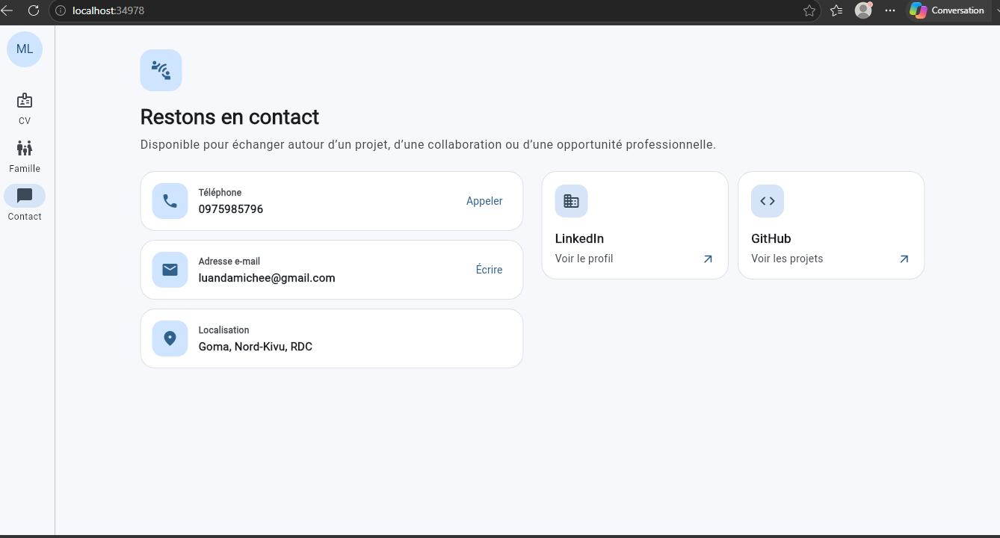

# cv_flutter_michee

Application Flutter de présentation professionnelle de Michee Luanda : CV, famille, compétences, expérience et informations de contact.

## Aperçu de l'application

### Page de connexion

La page d'authentification permet d'accéder à l'application et présente une interface simple, moderne et adaptée aux écrans mobiles.

### Page d'accueil

La page d'accueil présente le profil professionnel, les informations principales et les contenus essentiels du CV.

### Page Famille

La page Famille met en valeur les proches de Michee avec leur lien de parenté, leur nom, leur description et leur photographie.

### Page Contact

La page Contact facilite la prise de contact et rassemble les informations permettant d'échanger ou de proposer une opportunité professionnelle.

## Getting Started

This project is a starting point for a Flutter application.

A few resources to get you started if this is your first Flutter project:

- [Learn Flutter](https://docs.flutter.dev/get-started/learn-flutter)
- [Write your first Flutter app](https://docs.flutter.dev/get-started/codelab)
- [Flutter learning resources](https://docs.flutter.dev/reference/learning-resources)

For help getting started with Flutter development, view the
[online documentation](https://docs.flutter.dev/), which offers tutorials,
samples, guidance on mobile development, and a full API reference.
